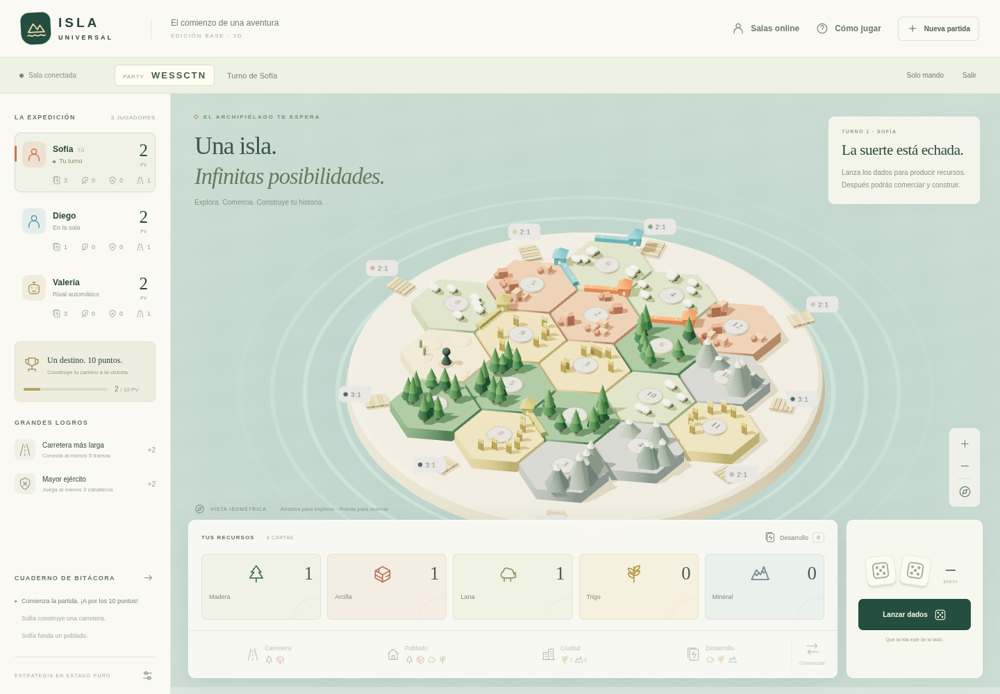
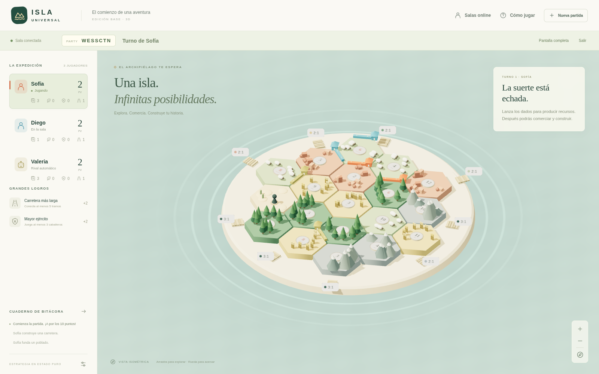
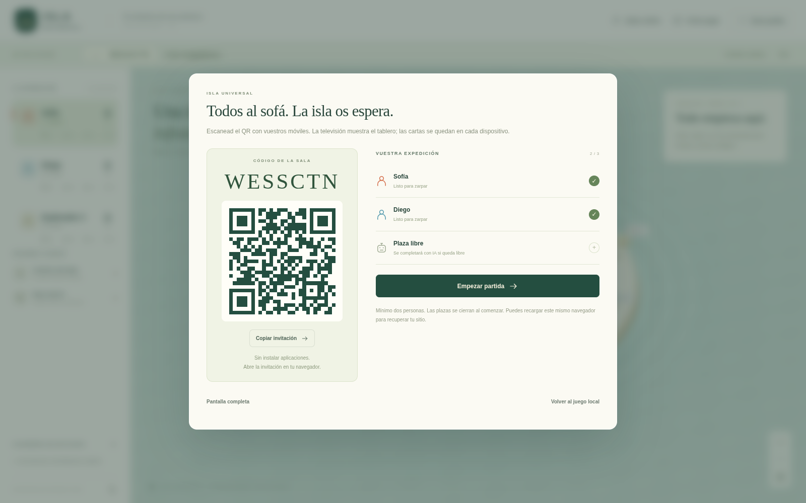
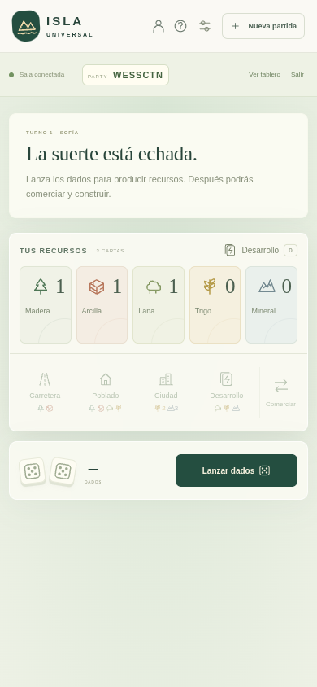

<div align="center">


# Isla Universal

**Una isla. Infinitas posibilidades.**

Construye poblados, negocia recursos y reúne a tus amigos alrededor de un tablero 3D.

**[▶ Jugar ahora](https://isla-universal.vercel.app/)** · [Capturas](#capturas) · [Modos de juego](#modos-de-juego) · [Desarrollo](docs/DEVELOPMENT.md)

<sub>THREE.JS · TYPESCRIPT · VITE · VERCEL</sub>

</div>

<br>

[](https://isla-universal.vercel.app/)

> Juego de estrategia en español, inspirado en las mecánicas del juego base de CATAN, con identidad visual propia y modelos generados en código. Juega desde el navegador, sin instalar aplicaciones ni crear una cuenta.

## Modos de juego

| Modo | Con quién juegas | Cómo se juega |
| --- | --- | --- |
| 🤖 **Solo** | Tú y rivales automáticos | Construye, negocia y compite contra la IA. |
| 🏠 **Local** | Amigos en el mismo dispositivo | Comparte la pantalla y pasa el dispositivo entre turnos. |
| 🌍 **Online** | Amigos desde cualquier lugar | Crea una sala y comparte su código, enlace o QR. |
| 📺 **Party** | Amigos con sus propios móviles | El tablero en la televisión y las cartas privadas en cada móvil. |

**Clásico: 3–4 jugadores. Ampliado: 5–10 jugadores.** Ambos están disponibles en Solo, Local, Online y Party. Online y Party necesitan al menos dos personas; las plazas restantes se completan con IA.

Para probar el ampliado tú solo: **Nueva partida → Un jugador + rivales automáticos → Ampliado → 10 jugadores**. Jugarás contra nueve bots.

## Modo ampliado

Elige **Ampliado** al crear una partida o una sala. Los costes, las dos construcciones iniciales, la producción de poblados/ciudades y la victoria a 10 puntos se mantienen.

| Jugadores | Parcelas | Desiertos | Banco por recurso | Desarrollo | Puertos |
| --- | ---: | ---: | ---: | ---: | ---: |
| 5–6 | 30 | 2 | 30 | 38 | 11 |
| 7–8 | 38 | 2 | 40 | 50 | 13 |
| 9–10 | 49 | 3 | 50 | 63 | 15 |

Tras cada turno principal, construye el jugador situado media vuelta más adelante —cinco posiciones en una partida de diez; redondeando hacia abajo con un número impar—. En esa **construcción intermedia** puede construir, mejorar ciudades, comprar desarrollo o pasar; no tira, comercia ni juega cartas. Cada jugador recibe una fase intermedia por vuelta y puede ganar en ella. Después continúa el siguiente turno principal.

El banco es común y sus existencias son visibles. Los recursos vuelven al banco al pagar o descartar; con un 7 se sigue descartando la mitad si se tienen más de siete cartas. Si no alcanza un recurso para varios destinatarios, ninguno lo recibe; si solo debe cobrar uno, recibe lo que quede. El historial avisa de la escasez.

**Monopolio** afecta a entre uno y tres rivales elegidos, sin revelar sus manos. Cada bot propone como máximo dos intercambios por turno principal. Se conservan un solo ladrón y los límites de cinco poblados, cuatro ciudades y quince carreteras por jugador.

Los mapas ampliados conservan números simétricos entre 2/12, 3/11, 4/10, 5/9 y 6/8, sin seises ni ochos adyacentes. Las cantidades son una primera configuración de equilibrio para probar jugando.

## Capturas

### El tablero en la televisión

La isla, los poblados, las carreteras y los puntos quedan a la vista de todos. La pantalla de TV no ocupa plaza de jugador ni recibe manos privadas.



<table>
<tr>
<td width="72%" align="center"><strong>Una sala, un código y un QR</strong></td>
<td width="28%" align="center"><strong>Tu móvil es el mando</strong></td>
</tr>
<tr>
<td valign="top"></td>
<td valign="top"></td>
</tr>
<tr>
<td valign="top">Comparte la invitación y reúne a los jugadores antes de empezar.</td>
<td valign="top">Consulta tus recursos y decide tu siguiente jugada.</td>
</tr>
</table>

<sub>Capturas de una partida de demostración. Para entrar en una partida, utiliza el QR de tu propia sala.</sub>

## Empieza a jugar

### Una partida rápida

1. Abre **[Isla Universal](https://isla-universal.vercel.app/)**. La partida inicial te enfrenta a dos rivales automáticos.
2. Pulsa **Nueva partida** para elegir tu nombre, el modo y el número de jugadores.
3. Coloca tus dos poblados iniciales y sus carreteras gratuitas.
4. Lanza los dados, construye y comercia. **Gana quien alcance 10 puntos de victoria durante su turno.**

Arrastra el tablero para girar la cámara y usa la rueda o los botones **+/−** para acercarte. Puedes construir directamente sobre el tablero o utilizar **Ver ubicaciones**.

En **Ajustes → Sonido y música** puedes activar los efectos de dados, construcciones, intercambios y avisos, además de una música ambiental suave. Cada canal tiene su propio volumen. Tus preferencias se guardan en el navegador y el audio se pausa al ocultar la pestaña.

### Online con amigos

1. Entra en **Salas online → Online** y crea una sala.
2. Comparte el **código de siete caracteres**, el enlace o el QR.
3. Cada amigo entra desde su navegador y elige su nombre.
4. Todos pulsan **Estoy listo** y el anfitrión selecciona **Empezar partida**.

Cada participante ve su propia mano. Los intercambios llegan al dispositivo de su destinatario y cada jugador elige sus propios descartes.

### Party: todos al sofá

1. Abre el juego en el navegador de la **televisión**, o conecta un ordenador por HDMI o duplicación de pantalla.
2. Selecciona **Salas online → Party · TV**.
3. Los jugadores escanean el QR con sus móviles. El anfitrión también se une como jugador desde otro dispositivo.
4. Marcaos como listos y comenzad desde la pantalla de TV.

El móvil muestra tus cartas y las acciones de tu turno. **Elegir ubicación** usa los números de cruces y tramos que aparecen en la TV; **Ver tablero** permite consultar también el tablero 3D en el móvil. Todos los dispositivos necesitan internet y pueden estar en redes diferentes.

## Lo que encontrarás en la isla

- **Un tablero diferente en cada partida:** 19 hexágonos en Clásico y hasta 49 en Ampliado, cinco recursos, puertos y distribución sin 6 y 8 adyacentes.
- **Construcciones 3D:** funda poblados, traza carreteras y mejora tus asentamientos a ciudades.
- **Comercio con decisiones:** banco, puertos e intercambios entre personas e IA con aceptación explícita.
- **Cartas de desarrollo:** caballeros, carreteras, monopolio, abundancia y puntos de victoria secretos.
- **El ladrón:** descartes con un 7, bloqueo de producción y elección de una carta rival boca abajo.
- **La carrera por los puntos:** carretera más larga, mayor ejército y victoria a 10 puntos.
- **Arte procedural:** bosques, ovejas, montañas, cultivos, muelles y océano animado, modelados en código.

<details>
<summary><strong>🤝 Cómo negocia la IA</strong></summary>

En tu turno, abre **Comerciar → Entre jugadores**, selecciona un rival y elige los recursos que entregas y pides. La IA valora sus recursos, las construcciones que puede preparar, la producción del tablero y los puntos públicos del rival; puede rechazar una oferta aunque pueda pagarla.

La IA también propone intercambios durante su turno. La partida espera tu aceptación o rechazo y las cartas solo cambian de mano tras aceptar. Cada rival automático propone como máximo un trato a cada participante por turno.

Sus propuestas usan su propia mano, el tablero y las cantidades públicas de cartas, sin consultar los tipos de recursos ocultos de sus rivales.

</details>

<details>
<summary><strong>🃏 Cómo funciona el robo del ladrón</strong></summary>

Después de mover el ladrón, elige un rival con un poblado o ciudad junto a esa parcela y al menos una carta de recurso. Si solo hay uno, su mano aparece directamente boca abajo. Pulsa una carta para completar el robo.

Los reversos no revelan tipos de recursos. Sus posiciones se barajan al robar y todas tienen la misma probabilidad de contener cada carta. Las cartas de desarrollo quedan excluidas. Si nadie es elegible, el turno continúa con una explicación.

El mismo flujo se aplica a los caballeros y conserva la fase de dados si se juegan antes de lanzar. Los robos y las ofertas pendientes se recuperan al recargar la partida.

</details>

## Guardado y reconexión

| Partidas locales | Salas Online y Party |
| --- | --- |
| Guardado automático en este navegador. | Estado guardado en el servidor. |
| Exporta e importa partidas JSON desde **Ajustes**. | Recupera tu plaza desde el enlace de la sala en el **mismo navegador**. |
| Pantalla de traspaso para compartir el dispositivo. | Solo recibes tus cartas privadas; la TV recibe datos públicos. |

Las salas duran **48 horas desde su creación**. Conserva los datos del sitio para recuperar tu acceso. Después de empezar solo pueden volver los participantes originales; si alguien se desconecta, la partida espera sus acciones. No hay sustitución automática ni migración del anfitrión.

La pantalla de traspaso local es una medida de cortesía: la partida completa reside en el navegador. En Online y Party, el servidor valida las reglas y oculta las manos ajenas antes de enviarlas.

## Para desarrollar

Requiere **Node.js 24** y npm. En desarrollo, las salas se guardan en archivos locales y no necesitan credenciales externas.

```sh
git clone https://github.com/Rapidfiend34/CatanUniversal.git
cd CatanUniversal
npm ci
npm run dev -- --port 5173
```

Abre **http://localhost:5173**.

| Comando | Qué hace |
| --- | --- |
| `npm test` | Reglas, integración del servidor y partidas completas de IA. |
| `npm run build` | Comprueba TypeScript del cliente y servidor y genera `dist/`. |
| `npm run test:e2e` | Prueba la interfaz con navegadores independientes y móviles simulados. |

**[Guía técnica y arquitectura →](docs/DEVELOPMENT.md)**

**[Despliegue de producción en Vercel →](DEPLOYMENT.md)**

Para publicar Online y Party necesitas desplegar también la API y conectar almacenamiento privado. La guía técnica incluye la configuración, la privacidad y los límites operativos.

---

<sub>Adaptación independiente inspirada en CATAN. No utiliza ilustraciones, modelos ni recursos oficiales. Incluye las mecánicas del juego base: las expansiones, barcos y puentes no están implementados. La IA es heurística y no se permite comerciar antes de lanzar los dados.</sub>
